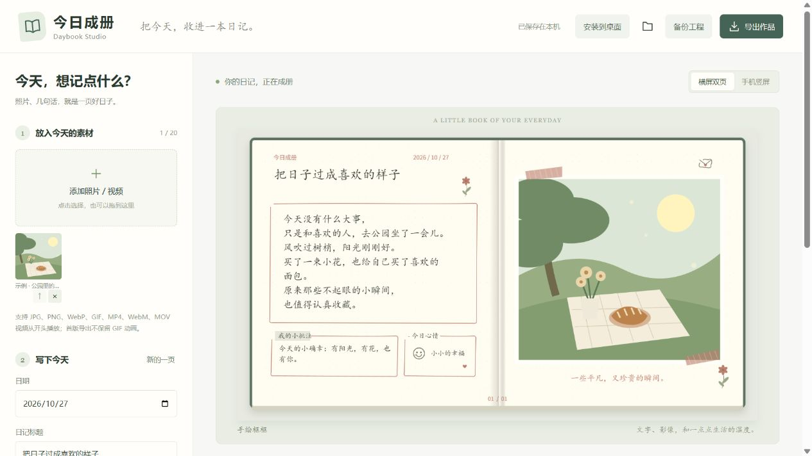

# 今日成册 · Daybook Studio

把今天，收进一本日记。上传照片或视频，写几句话，选择一本喜欢的本子，导出图片或视频。

一个本地优先的开源日记视频工作室，支持电脑和手机浏览器。基础使用无需账号、服务器和 AI 密钥。



## 可以做什么

- 8 款本子：手绘框框、奶油日常、复古旅行、晴蓝活页、森林纸笺、电影收藏、私信聊天、口袋日记。
- 横屏双页 / 手机竖屏，两种独立排版；切换本子保留内容。
- 上传图片和视频、调整顺序、按页指定素材；长文自动续页，多份素材自动增加页面。
- 日记、日期、心情、批注；装饰三档、图片完整显示或铺满、每页时长。
- 逐句入页动画；PNG、MP4 或 WebM 导出，可选择保留视频原声。
- IndexedDB 本机保存；包含原始素材的 ZIP 工程包备份与恢复。
- PWA 安装和离线缓存；静态站点、GitHub Pages 和 Docker 部署。

这是 v0.1 首版。自然卷曲翻页、人物口型、自由拖拽排版、AI 生图和原生安装包尚未实现。八款使用共用绘图核心，有各自纸张、装订或内容分区；社区可以继续丰富每款的构图。

## 快速开始

需要 Node.js 24，首次安装需要联网。

```sh
npm ci
npm run dev
```

打开 <http://127.0.0.1:8798>。Windows 也可双击项目中的 `启动今日成册.bat`，终端窗口需保持打开。

1. 选择照片或视频；第一次上传会替换示例插画。
2. 写下日记，选择日期、标题、心情和小批注。
3. 选择本子和横竖屏；长文及多份素材会自动增加页数。
4. 点击“导出作品”，选择当前页 PNG 或全部页视频。

用“本页素材”更换当前页图片。工程会保存在当前浏览器，但**清理浏览器数据会丢失本地工程**；请使用“备份工程”把文字与素材一起保存。不同网址/端口的浏览器存储互相独立，换设备或部署地址前先备份。

## 部署

### 静态站点

```sh
npm run build
npm run preview
```

将 `dist/` 发布到任意支持 HTTPS 的静态托管。资源使用相对路径，可部署到子目录。构建脚本会把视频导出模块一并加入离线缓存。

### GitHub Pages

仓库 Settings → Pages → Source 选择 **GitHub Actions**。在 Actions 手动运行 **Publish GitHub Pages**。项目附带 CI 编译与核心逻辑测试。

### Docker

```sh
docker compose up --build -d
```

打开 <http://localhost:8798>。容器只提供静态页面，不接收日记数据；数据仍保存在访问者的浏览器里。

### 手机使用与安装

推荐访问 HTTPS 部署地址。Android 在浏览器菜单选择安装；iPhone 用 Safari 的分享菜单选择“添加到主屏幕”。首次打开需联网，生产构建缓存完成后可离线编辑和导出，设备仍需支持对应编码。

开发时要在局域网手机试用，可运行：

```sh
npm run dev -- --host 0.0.0.0
```

手机访问 `http://电脑的局域网IP:8798`，需要电脑防火墙允许。HTTP 局域网地址可能不具备 PWA 安装和视频编码所需的安全上下文；正式体验请使用 HTTPS。手机上的 `127.0.0.1` 指手机自己。

## 素材与导出限制

| 项目 | 首版支持 |
|---|---|
| 图片 | JPG、PNG、WebP、GIF（GIF 导出为静态画面） |
| 视频 | MP4、WebM、MOV 容器，实际解码取决于设备，优先 H.264/AAC MP4 |
| 素材数量 | 最多 20 份，单份不超过 200 MB |
| 日记长度 | 最多 10000 字，自动续页 |
| 图片输出 | 当前页 PNG，横屏 1600×900、竖屏 900×1600 |
| 视频输出 | 全部页、24 fps、720p / 1080p，最长 3 分钟 |
| 视频时长 | 每页 3 / 6 / 9 / 12 秒；片段从开头播放，结束后停在最后一帧 |
| 原声 | 用户勾选时保留当前页对应视频的原声；不循环、不添加背景音乐 |
| 工程备份 | ZIP，素材总计最多 400 MB，包含文字、模板设置与原始素材 |

导出前实际检测 H.264/VP9 和 AAC/Opus 编码能力。设备不支持时给出提示，可尝试 WebM、720p 或新版 Chrome / Edge。不能保证所有 iPhone/Android 型号都能导出视频。导出时保持页面前台，避免锁屏。

当前导出使用主线程分批处理，并定期让出界面事件循环；使用帧级背压，但输出文件与单页音频仍占用内存。Worker、流式文件保存和原生编码是后续优化方向。低内存手机请先用 720p 短作品。

标题超过两行、批注超过两行时，画面只展示前两行，完整文字保留在工程中。字体使用设备自带楷体或衬线体，不同系统外观会略有差异。

## 隐私与开源

素材读取、排版、编码都在当前设备进行，没有上传 API、分析 SDK、远程字体、广告或登录流程。PWA 的更新会下载程序文件。请自行保管导出的视频与工程包。

代码为 MIT，原创示例插画和应用图标也以 MIT 提供。Mediabunny 为 MPL-2.0，fflate 为 MIT，见 [第三方说明](THIRD_PARTY_NOTICES.md)。本项目不包含商业模板、影视片段或他人的日记。

设计与流程研究参考 [Canva](https://www.canva.com/create/scrapbooks/)、[时光手帐](https://www.shouzhang.com/)、[1 Second Everyday](https://1se.co/)、[StoryPad](https://github.com/theachoem/storypad) 和 [Memos](https://github.com/usememos/memos)，未复制这些项目的代码或素材。

## 参与开发

```sh
npm test
npm run build
```

核心文件：

```text
src/model.ts       日记数据、主题注册、中文换行与分页
src/renderer.ts    统一 Canvas 绘图、模板结构和时间动画
src/media.ts       图片/视频读取、帧定位、原创示例
src/exporter.ts    编码能力检查、视频逐帧导出与原声
src/storage.ts     本机保存和工程包读写
src/main.ts        编辑器交互
public/sw.js       生产环境离线缓存
scripts/finalize.mjs  构建后的缓存资源清单
```

欢迎改进模板、中文排版、手机兼容和导出性能。详情见 [贡献指南](CONTRIBUTING.md)、[路线图](ROADMAP.md) 和 [实测记录](docs/VERIFICATION.md)。
